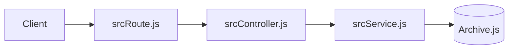
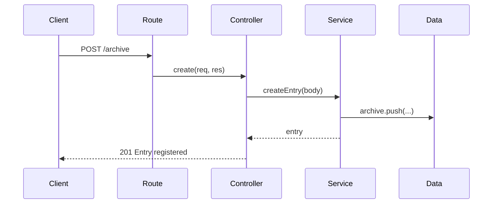
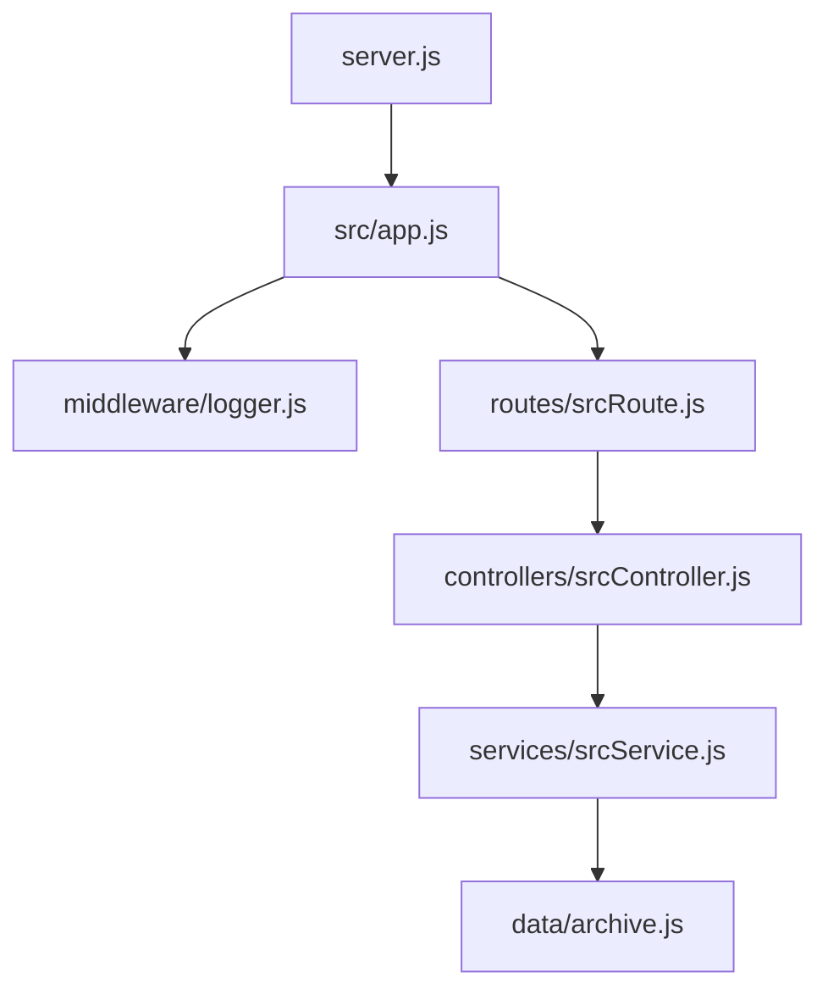

## Arkitektur

Vi har valgt denne aritektur fordi den giver bedre oversigt over programmet og dens koden,
det er letter at teste, isolere og bug fikse når små dele af koden er bredt ud over programmet. -Niels

denne struktur er også i overensstemmelse med clean code arkitekuren som vi er blevet lært. den opretholder en standerd som gør det nemmer at diagnostisere problem og bugs i koden. -G.Olsen

refleksion:

1. "Hvad ville I ændre, hvis applikationen skulle anvendes af mange brugere? "

Hvad vi ville ændre ville være at gøre programmet kører async som en i øjeblikket ikke går. -Niels

2. "Hvilke fejl fandt I under udvikling og test?"

Vi har haft fundet et par fejl undervejs, vis vi laver metoder i controller som starter med exports."functions navn"
Så ville vi ikke kunne bruge module.exports.
Vi har så valgt at bruge normale functions og exportere dem. -Niels

Vi har fundet nogen små fejl omkring validation som et check om en value som skal være en "string",
Men er sat om som den kaster en fejl vi valuen er en "string", som den skal være. -Niels

En check om navn var for kort, var sat som vis navn ikke er under 2 bogstaver så kast en error. -Niels

Med redirect var der et problem med hvor den sad i routes, vi fandt ud af at man kan ikke have getDownload
under en anden get metode som modtog en /:id. -Niels

Afsluttende refleksion 

1. "Hvad der sker, når frontend sender en request til backend."

Når et som eksempel get request kommer ind, sender vores frontend stien ned til vores server som sender en til routes,
vis routes ikke tager sig af kommer vi tilbare til app.js og brugere vores app.use methode,
som sider efter vores routes kald og sender en 404 tilbage til brugeren.
Den kan også side i routes til sidst for sikre sig at routes klare alt med endpoints også vi de ikke ekstiere. -Niels

2. "Hvordan Express finder den rigtige route."

Den anvender vores srcRoute som fortæller den om routen er en get, post, put, delete etc.
Den går igennem vores routes som om det var en lang if statement indtil den finder den korraket HTTP syntax
som matcher dens request.
Vis vi havde vores 404 fejl håndtering i vores routes til sidst ville den default til den vis ingen andre routes matchede.
Men vis den stod først ville vi den blive anvendt til alle routes. -Niels

3. "Hvor data bliver valideret."

Vi validere vores data i srcService når vi sender data'en der ned, vi han anvendt functioner
til at validere hver data type vi forventer at modtage.
Vis data'en ikke passer sender vi en passende status kode tilbare med et svar på hvad der er gået galt. -Niels

4. "Hvordan HTTP-statuskoder anvendes."

http statuskoderne bliver brugt til at svarer tilbage på om forspørgelsen 
som klienten har sendt er blevet gennemført eller fejlede.
når kalder på creatEntry bruger vi status kode 201 vis kreationen af en ny entry er gået igennem men vis der gik noget galt bruger vi status kode 500 server error.
vis vi nu ledte efter en entry med et id i findEntryById så vil vi sende en status kode 200 altså OK for at fortælle at forspørgelsen er modtage, men vi bruger ikke 201 fordi 201 bliver kun brugt vis forspørgelsen handler om at udgør en opgave eller slette/skabe noget.
vis man gik op search baren og sågte efter /stith som vi ikke har routed for så sender vi den klassiske 404 page not found.-G.olsen

5. "Hvordan applikationen er opdelt. "

Applikationen er opdelt i ansvar, vores server.js starter serveren og lytter på den PORT den er sat til og ikke mere.
Vores app.js håndtaggere vores brug af middleware og hvor vores routes starter fra som er "". -Niels

Vores srcRoute.js håndtaggere hvad for nogle endpoints vi har og om de er get, post, put, delete etc. -Niels

srcController håndtaggere hvad for en function hvert endpoint har, som createEntry bruges til at lave flere karakterer.
Den er også den som skal modtage frontends paramter og request bodies.-Niels

srcService er vores business layer, den håndtaggere vores validation hvor den sikre sig at data'en er der og
opfølger vores relger. -Niels

archive.js fungere som data/repositroy layer, den holder vores data og er der vi gerne vil gemme. -Niels

logger.js er vores eget middleware som fungere som en logger, den skriver ikke ned persistent men udskriver til console,
hvad er blivet kaldt og hvornår. -Niels

6. "Hvordan I har testet funktionaliteten. "

Vi har anvendt postman til at kalde vores endpoints, både for teste om det virker når det skal og om den applikationen
ordenligt tager sig af fejl og validere data korrekt med fejl beskeder. -Niels
